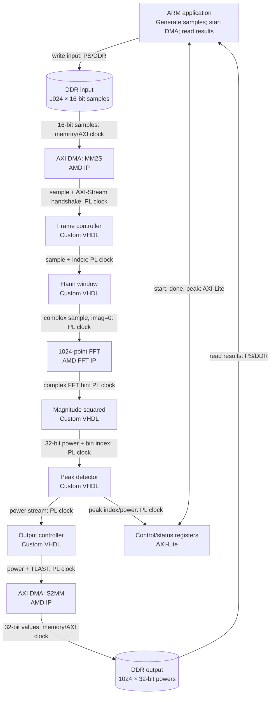

# 1024-Point FFT Spectrum Analyzer

A hardware-accelerated spectrum analyzer for the AMD Kria KV260. The ARM processor supplies a signal, and the FPGA returns its frequency spectrum and strongest frequency bin.

The FPGA handles the signal processing. AMD IP provides the FFT and memory transfers; custom VHDL handles windowing, power calculation, peak detection, and stream control.

## Input and output

**Input:** 1024 signed 16-bit real samples stored in DDR memory. The software also specifies the sample rate, used only to convert an FFT bin number into hertz.

**Output:**
- **Power spectrum:** 1024 unsigned 32-bit power values, one for each FFT bin, written back to DDR.
- **Peak:** The strongest bin among bins 0–512 and its power, exposed through status registers. Its frequency is `peak_bin * sample_rate_hz / 1024`.

The 32-bit output is a **scaled fixed-point** measure of `real² + imaginary²`. The FFT scaling, rounding, and power normalization must be consistent between the RTL and software reference.

## Example Inputs and Outputs

The accelerator receives 1024 signed 16-bit samples and returns 1024 unsigned 32-bit power values representing the frequency spectrum. It also identifies the strongest frequency bin.

The following examples assume a sample rate of 48 kHz, giving a frequency resolution of:

```
Frequency Resolution = 48000 / 1024 = 46.875 Hz
```

### Example 1: Single Frequency (1 kHz)

**Input:** A 1 kHz sine wave containing 1024 samples.

```text
Input Samples:
[0, 4277, 8481, 12540, 16384, ...]
```

**Output:**

```text
Power Spectrum:
[small, small, ..., PEAK, ..., small]

Peak Bin:       21
Peak Frequency: 984.375 Hz
```

The strongest frequency bin is near 1 kHz. The Hann window reduces spectral leakage into other frequency bins.

### Example 2: Multiple Frequencies (1 kHz and 5 kHz)

**Input:** A signal containing two sine waves at 1 kHz and 5 kHz.

```text
Input Signal:
signal = sine(1000 Hz) + sine(5000 Hz)
```

**Output:**

```text
Power Spectrum:
Two peaks near bins 21 and 107

Peak Bin:       21 or 107
Peak Frequency: 984.375 Hz or 5015.625 Hz
```

The spectrum contains two peaks representing the two frequencies. The strongest peak depends on the amplitude of each sine wave.

### Example 3: Constant Signal (DC)

**Input:** A constant signal with all 1024 samples equal to 1000.

```text
Input Samples:
[1000, 1000, 1000, 1000, ..., 1000]
```

**Output:**

```text
Power Spectrum:
Largest value at bin 0

Peak Bin:       0
Peak Frequency: 0 Hz
```

The strongest frequency component is at 0 Hz because the input is constant. Hann windowing also produces some energy in neighboring bins.

### Software Output

After processing, the ARM application reads the power spectrum and peak information from the FPGA.

Example terminal output:

```text
FFT Size:          1024
Sample Rate:       48000 Hz
Peak Bin:          21
Peak Frequency:    984.375 Hz
Verification:      PASS
FPGA Processing:   <measured time>
```

The complete 1024-bin power spectrum is stored in DDR memory and can be used for plotting or further analysis.

Actual power values depend on the FFT's fixed-point scaling and rounding configuration.

## How it works



The main FPGA processing path uses one PL clock, targeting **200 MHz** if timing permits. The memory and control clocks come from the block design; clock conversion is included only if required.

### What each block does

| Block | Job |
| --- | --- |
| **ARM application** | Generates samples, configures the hardware, and checks the returned spectrum. |
| **AXI DMA (AMD IP)** | Streams samples from DDR into the FPGA and returns results to DDR. |
| **Frame controller** | Accepts and counts exactly 1024 samples per FFT frame. |
| **Hann window** | Multiplies each sample by a stored window coefficient to reduce spectral leakage. |
| **FFT (AMD IP)** | Computes the 1024-point forward FFT and produces complex bins in natural order. |
| **Magnitude squared** | Computes the scaled power of each complex FFT bin. |
| **Peak detector** | Finds the largest power in bins 0–512 while passing all power values onward. |
| **Output controller** | Streams 1024 powers to DMA with correct AXI-Stream framing. |
| **Control/status registers** | Provide start/status and peak information to the ARM application. |

The custom streaming blocks preserve AXI-Stream `TVALID`/`TREADY` behavior and frame boundaries. The FFT IP performs the butterflies, twiddle multiplication, internal buffering, and output ordering.

## Repository layout

```text
fft-accelerator/
├── rtl/
│   ├── fft_top.vhd                # Connects custom blocks to the FFT stream
│   ├── fft_pkg.vhd                # Shared formats and constants
│   ├── frame_controller.vhd       # Input framing
│   ├── window_engine.vhd          # Hann multiplication and coefficient ROM
│   ├── magnitude_squared.vhd      # Real² + imaginary²
│   ├── peak_detector.vhd          # Maximum power and bin index
│   ├── output_controller.vhd      # Output framing
│   └── control_regs.vhd           # AXI-Lite control/status
├── tb/
│   ├── tb_window_engine.vhd
│   ├── tb_magnitude_squared.vhd
│   ├── tb_peak_detector.vhd
│   ├── tb_fft_top.vhd
│   └── test_vectors/              # Generated simulation data
├── sw/
│   ├── fft_test.cpp               # DMA, result checking, and timing
│   └── Makefile                   # Builds the AArch64 executable
├── scripts/
│   ├── generate_window.py         # Generates Hann coefficients
│   ├── generate_test_vectors.py   # Generates test input/reference data
│   └── compare_results.py        # Compares saved results
├── vivado/
│   ├── create_project.tcl         # Sets device, sources, and constraints
│   ├── create_bd.tcl              # Creates PS, DMA, FFT, and AXI connections
│   ├── run_sim.tcl                # Runs RTL simulation
│   ├── build.tcl                  # Runs synthesis and implementation
│   └── constraints.xdc            # Timing constraints
├── results/
│   └── README.md                  # Recorded performance measurements
├── .gitignore                     # Ignores generated project/build files
└── README.md
```

Vivado IP and block designs are recreated from Tcl; generated Vivado folders and compiled executables are not committed.

## Build and run

**Requirements:** Git, Python 3, Vivado with KV260 support, and an AArch64 C++ compiler (or a machine that can build and run the software on the KV260).

The commands below define the intended repository build flow. **The Tcl scripts and RTL must be implemented before these commands will work end-to-end.** Use the same Vivado version for rebuilding the project where possible.

### 1. Clone and generate input files

```bash
git clone <repository-url> fft-accelerator
cd fft-accelerator
python3 scripts/generate_window.py
python3 scripts/generate_test_vectors.py
```

Replace `<repository-url>` with this repository's HTTPS or SSH clone URL. The generators create the coefficient data and simulation vectors consumed by the VHDL and testbenches.

### 2. Create the Vivado project

From the **repository root**, in a terminal with Vivado on `PATH`:

```bash
vivado -mode batch -source vivado/create_project.tcl
```

`create_project.tcl` is responsible for creating `build/vivado/`, adding the RTL and constraints, calling `vivado/create_bd.tcl` to assemble the processing system, DMA, FFT IP, and AXI connections, and generating the IP output products.

To inspect the generated project in the Vivado GUI:

```bash
vivado build/vivado/fft_accelerator.xpr
```

### 3. Run simulation

```bash
vivado -mode batch -source vivado/run_sim.tcl
```

`run_sim.tcl` runs the accelerator testbench with known input signals and checks its output against generated reference data. The unit testbenches are also available for debugging individual RTL blocks.

### 4. Build the FPGA `.bin` file

```bash
vivado -mode batch -source vivado/build.tcl
```

`build.tcl` opens the project, runs synthesis and implementation, generates the bitstream with Vivado's **binary bitstream output enabled**, and places the resulting file at:

```text
build/fft.bin
```

This build script must fail if synthesis, timing, implementation, or bitstream generation fails; it must not report success when the `.bin` file is missing.

### 5. Build the ARM application

On the ARM target or with an AArch64 cross-compiler:

```bash
make -C sw
```

The Makefile produces `sw/fft_test`, an **AArch64 Linux** executable. A normal x86-64 build will not run on the KV260.

### 6. Run on the KV260

Transfer the executable and bitstream to the machine with access to `kv-submit`, then run:

```bash
kv-submit -s ./sw/fft_test -b ./build/fft.bin
```

The application generates a signal, runs the accelerator, reads the resulting spectrum and peak, and prints correctness and timing measurements. The software must configure both DMA directions and wait for the output transfer to finish before reading results.

## Verification

Test with an impulse, single sine wave, multiple sine waves, and random samples. Compare the returned power spectrum and peak bin against a software implementation using the **same Hann window and fixed-point scaling**.

Record **FPGA processing latency**, **end-to-end time including DMA**, **frames per second**, and **LUT/FF/BRAM/DSP usage**. Compare the full hardware processing path with a software window + FFT + power + peak implementation on the ARM processor.
